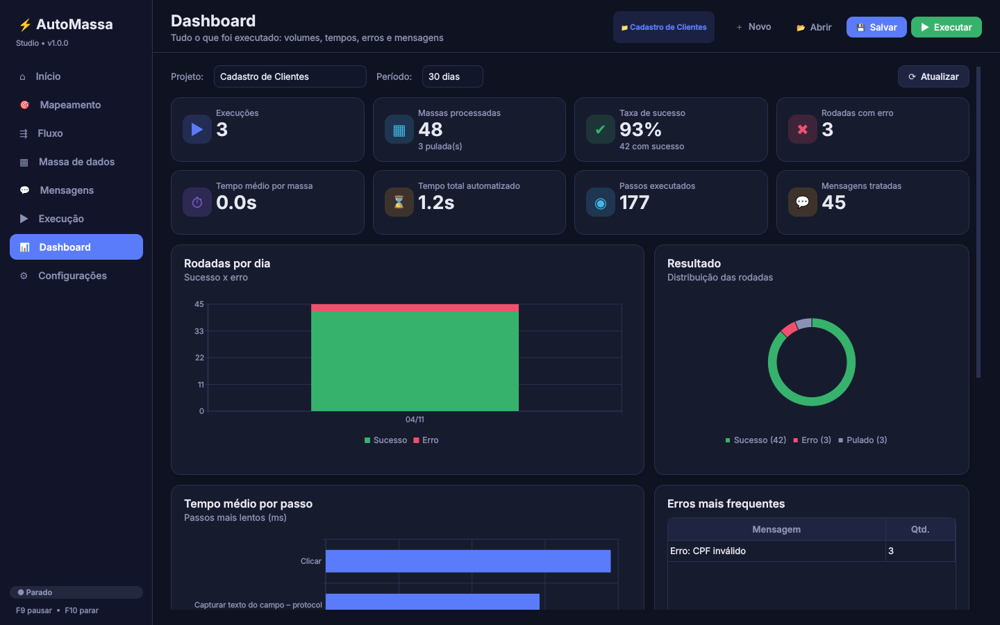

# ⚡ AutoMassa Studio

Programa desktop (Windows) para **automatizar a criação de massas de dados** em sistemas **web** e **executáveis**.
Você mapeia os campos com um clique, monta o fluxo, prepara a massa no Excel e executa, com controle de tempo,
tratamento de mensagens, capturas de tela e um dashboard com tudo o que foi feito.



---

## Recursos

| Área | O que faz |
|---|---|
| **Mapeamento por clique** | **Executável:** um realce acompanha o mouse sobre o sistema; o clique é interceptado (não chega ao sistema) e o campo é mapeado via UI Automation (WinForms, WPF, Win32, Delphi, VB6, Java, Qt…). **Web:** abre Edge/Chrome com perfil próprio (logins ficam salvos) e mapeia elementos com seletores robustos (id, name, data-testid, aria-label, texto, caminho CSS, XPath, iframes). Também há o modo **“Mapear vários”** (sequência até ESC). |
| **Listas carregadas automaticamente** | Ao mapear um ComboBox, `<select>`, grupo de radio, datalist ou dropdown ARIA, **todos os valores da lista** vêm para dentro do programa e para o Excel (aba *Listas* + menu suspenso com validação na aba *Massa*). Botão **Recarregar lista** para atualizar. |
| **Massa de dados (data table)** | Colunas sugeridas a partir dos campos/fluxo; editor com menu suspenso nas listas; **Gerar linhas** com dados válidos (CPF/CNPJ com dígito verificador, nomes, e-mails, telefones, CEP, datas, placas…); filtro; colunas de controle (Executar S/N, Status, Mensagem, Executado em, Duração). |
| **Excel** | **Exportar** (abas *Massa*, *Listas*, *Campos*, *Instruções*, cabeçalhos coloridos, validações), **Importar** (substituir ou acrescentar; edições na aba *Listas* atualizam os campos) e **Exportar resultado** com status e capturas. Fórmula `=GERAR(cpf)` em qualquer célula gera o valor na hora. |
| **Fluxo** | Passos: preencher, selecionar, clicar, duplo clique, marcar, teclas, aguardar tempo/elemento/sumir, **capturar texto**, **capturar tela**, **capturar mensagem**, validar texto, abrir URL/executável, focar janela, variável, verificar mensagens. Arrastar para reordenar, testar passo, gerar fluxo pelos campos, **fluxo de reinício**. |
| **Controle de tempo** | Multiplicador de velocidade, pausa entre passos e entre rodadas, atraso antes/depois por passo, tempo máximo para achar o campo, intervalo entre teclas. Tudo cronometrado e registrado. |
| **Erros** | Por projeto ou por passo: **perguntar**, **prosseguir**, **repetir**, **recomeçar a rodada** (executa o fluxo de reinício), **ir para a próxima rodada** ou **parar**. Tentativas automáticas, limite de recomeços, print automático no erro. Na janela de erro há a opção “aplicar aos próximos erros”. |
| **Mensagens** | Detecta caixas de diálogo do executável, `alert/confirm` e modais web (Bootstrap, SweetAlert, jQuery UI, ARIA…). Regras por texto/título (aceita regex `re:`): clicar e continuar, capturar e continuar, **capturar e ir para a próxima rodada**, recomeçar, tratar como erro. Mensagens **não previstas**: perguntar, **clicar automaticamente** (OK/Sim/Fechar…) ou capturar e ir para a próxima. Da janela de pergunta já dá para **criar a regra**. |
| **Captura** | Qualquer campo mapeado pode ter o texto capturado para uma coluna; prints de tela/janela/campo vão para a pasta de evidências e aparecem no dashboard. |
| **Execução** | Iniciar / **Pausar (F9)** / **Parar (F10)** com atalhos globais (funcionam com o foco no sistema alvo), escolha de linhas (todas, pendentes/erro, selecionadas, intervalo), progresso, tempo médio e previsão, log colorido e última captura ao vivo. |
| **Dashboard** | Execuções, massas processadas, taxa de sucesso, tempo médio por massa, tempo total, passos e mensagens; gráficos por dia, distribuição, tempo médio por passo, erros mais frequentes; histórico com detalhe de rodadas, linha do tempo dos passos, mensagens, capturas, galeria de prints e **relatório Excel**. |

---

## Como gerar o executável (.exe)

### Opção 1 — automático pelo GitHub
Cada push dispara o workflow **“Gerar executável Windows”** (`.github/workflows/build-windows.yml`).
Abra a aba **Actions** do repositório → execução mais recente → baixe o artefato **AutoMassaStudio-windows.zip**,
descompacte e rode `AutoMassaStudio.exe`.

### Opção 2 — na sua máquina Windows
Requisitos: Windows 10/11 e [Python 3.10+](https://www.python.org/downloads/) (marque *Add to PATH*).

```bat
build.bat            :: gera dist\AutoMassaStudio\AutoMassaStudio.exe (inicia mais rápido)
build.bat onefile    :: gera um único dist\AutoMassaStudio.exe
```

### Rodar sem gerar o .exe
Duplo clique em **`INICIAR.bat`** (na primeira vez instala as dependências automaticamente).

### Rodar a partir do código (desenvolvimento)
```bat
pip install -r requirements.txt
python run.py
```

> **Navegador:** o programa usa o **Microsoft Edge** (padrão) ou o **Chrome** já instalados — não precisa baixar
> nada. Se quiser o Chromium do Playwright, rode `python -m playwright install chromium` e escolha
> *Chromium* em Configurações.

---

## Passo a passo de uso

1. **Início** — dê um nome ao projeto e informe o executável/título da janela e/ou a URL do sistema.
2. **Mapeamento** — clique em **Mapear campo** (ou **Mapear vários**) e clique nos campos do sistema.
   Para web, informe a URL, clique em **Abrir** e depois em **Mapear na web**. Confirme nome/tipo; listas já vêm preenchidas.
3. **Fluxo** — os passos são criados automaticamente ao mapear (ou use **Gerar pelos campos**). Ajuste tempos,
   tentativas e o que fazer em erro. Monte um **Fluxo de reinício** (ex.: `Teclas {ESC}`, clicar em *Novo*, abrir URL).
4. **Massa de dados** — **Gerar linhas** ou **Exportar Excel**, preencha a planilha e **Importar Excel**.
5. **Mensagens** — revise as regras (já vêm regras para *sucesso*, *erro* e *confirmação*) e a política para mensagens não previstas.
6. **Execução** — **Iniciar** (F5). Use F9/F10 a qualquer momento. Em erros, escolha repetir, prosseguir, recomeçar, pular ou parar.
7. **Dashboard** — acompanhe resultados e abra cada execução para ver detalhes e prints. **Exportar resultado** gera o Excel com status e capturas.

### Dicas de valores
- Na coluna: `=GERAR(cpf)`, `=GERAR(cnpj)`, `=GERAR(nome)`, `=GERAR(lista:A|B|C)`.
- Em valor fixo: `{coluna}`, `{hoje}`, `{agora}`, `{linha}`, `{gerar:email}`.
- Teclas (executável): `{ENTER}`, `{TAB 3}`, `^s` (Ctrl+S), `%{F4}` (Alt+F4). Web: `Enter`, `Control+S` ou o mesmo formato.
- Título da janela e textos de mensagens aceitam regex com prefixo `re:` — ex.: `re:Cadastro.*Clientes`.

---

## Onde ficam os arquivos
| O quê | Local |
|---|---|
| Projetos (`.amproj`) e planilhas | `Documentos\AutoMassa\` |
| Prints / evidências | `Documentos\AutoMassa\evidencias\<projeto>\execucao_<n>\` |
| Histórico do dashboard (SQLite) | `%APPDATA%\AutoMassaStudio\historico.db` |
| Perfil do navegador (logins) | `%APPDATA%\AutoMassaStudio\navegador_*` |
| Log de erros inesperados | `%APPDATA%\AutoMassaStudio\erros.log` |

---

## Estrutura do código

```
automassa/
  app.py                 ponto de entrada
  core/
    models.py            campos, passos, regras, configurações, projeto
    engine.py            motor de execução (tempos, erros, mensagens, capturas)
    excel_io.py          exportação/importação Excel com listas e validações
    database.py          histórico SQLite para o dashboard
    generators.py        CPF, CNPJ, nomes, datas, etc.
    flow.py              sugestão de passos e geração de linhas
    storage.py           arquivos de projeto e preferências
  drivers/
    desktop.py           UI Automation (pywinauto) – executáveis
    web.py               Playwright (Edge/Chrome) – web
    web_picker.js        realce e captura de elementos na página
  ui/                    interface PySide6 (páginas, tema, mapeador por clique)
tests/                   testes do motor, Excel, web ponta a ponta e interface
automassa.spec           configuração do PyInstaller
build.bat                build no Windows
```

Testes: `python -m pytest -q tests`
